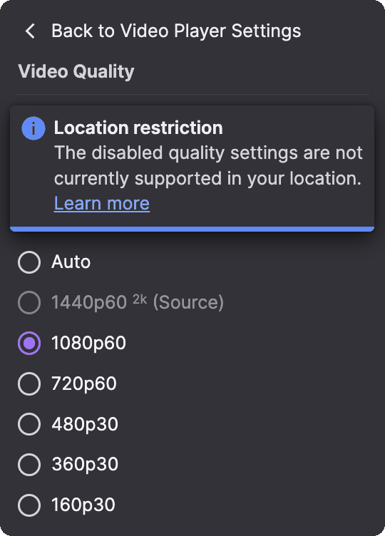
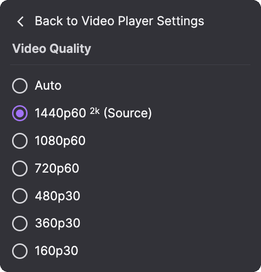
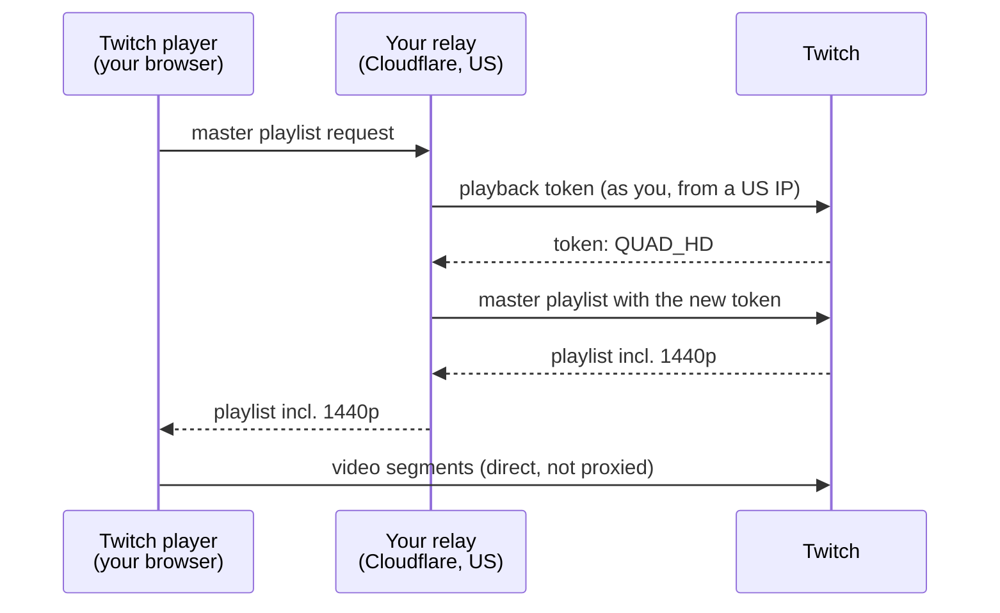
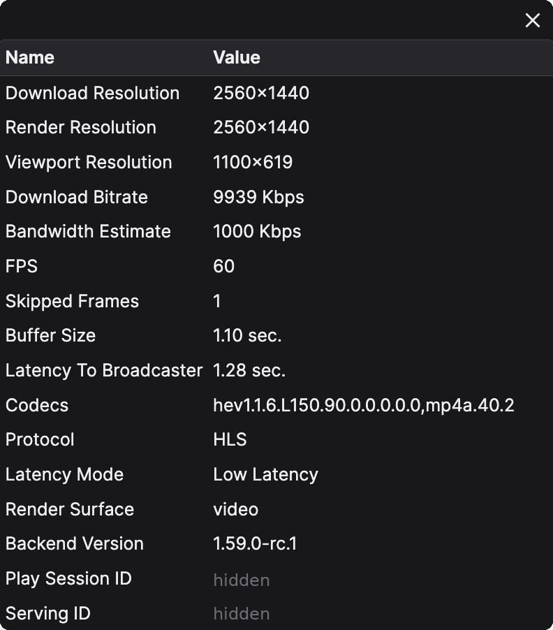
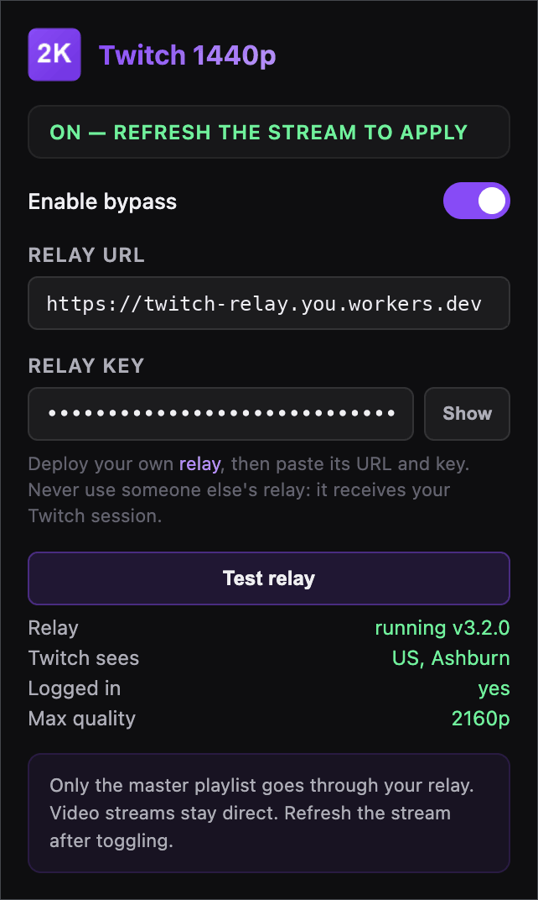

<div align="center">


# Twitch 1440p Relay

**Watch Twitch in 1440p from regions where it's capped at 1080p — no VPN.**

[](https://github.com/YogTandel/twitch-1440p-relay/actions/workflows/test.yml)
[](https://github.com/YogTandel/twitch-1440p-relay/releases)
[](LICENSE)

</div>

<table>
  <tr>
    <th>Without the extension</th>
    <th>With the extension</th>
  </tr>
  <tr>
    <td></td>
    <td valign="top"></td>
  </tr>
</table>

A small browser extension for Chrome, Edge, Firefox, Zen, Brave, Opera, Vivaldi and LibreWolf, plus a Cloudflare Worker **you deploy yourself**. Only the master playlist (a few KB) goes through the Worker; the video streams directly from Twitch, so there's no extra latency and no bandwidth cost.

> Based on [ddaccu/twitch-2k-unlocker](https://github.com/ddaccu/twitch-2k-unlocker). The original stopped working once Twitch moved playlist requests into the player's Web Worker; this version is reworked to handle that and fixes a security issue in the relay.

## How it works

Twitch decides the maximum quality when it issues the **playback access token**. The token records your IP, and for some regions it caps the stream at `FULL_HD` with reason `AUTHZ_GEO`. Twitch also grants 1440p only to **logged-in** viewers (`AUTHZ_NOT_LOGGED_IN`).

So the relay asks Twitch for the token on your behalf, from the US:



- `extension/hook.js` runs in the page and wraps `window.Worker`, injecting a `fetch` patch into the player's worker. Only usher `.m3u8` requests are redirected to your relay.
- `extension/bridge.js` passes the relay settings to the page and reports playback status back to the extension (toolbar badge).
- `relay/worker.js` requests a fresh token from Twitch GQL, swaps it into the usher URL and returns the playlist.
- `relay/wrangler.toml` pins the Worker near `aws:us-east-1`. Without this, Cloudflare runs it in the data center closest to you, and Twitch sees your region again.

<details>
<summary>Proof: player stats with the extension on</summary>
<br>

</details>

> 1440p only appears if the **streamer** broadcasts in 1440p (Enhanced Broadcasting). Twitch uses HEVC for it, so your browser needs HEVC hardware decoding (Chromium with hardware acceleration, or OS HEVC support in Firefox/Zen).

## Security — read this

- **The relay receives your Twitch session token.** It's needed to get a 1440p token on your behalf. The relay forwards it to `gql.twitch.tv` only and never logs or stores it. **Only ever use a relay you deployed yourself.** Never paste someone else's Worker URL into the extension.
- The relay requires an access key (`?key=...`). Without it, it answers `403`, so nobody else can use your Worker or your quota.
- The relay only accepts `https://usher.ttvnw.net` URLs (checked by parsed hostname) and only issues `PlaybackAccessToken` queries.

## Setup

You need a free [Cloudflare](https://dash.cloudflare.com/sign-up) account.

### 1. Deploy the relay

**Option A — command line** (needs [Node.js](https://nodejs.org) 20+):

```bash
git clone https://github.com/YogTandel/twitch-1440p-relay.git
cd twitch-1440p-relay/relay

npx wrangler login                  # opens the browser, click Allow
npx wrangler deploy                 # prints https://twitch-relay.<you>.workers.dev
openssl rand -hex 16                # copy the output
npx wrangler secret put RELAY_KEY   # paste it when asked
```

On Windows without OpenSSL, generate the key with Node instead:

```powershell
node -e "console.log(require('crypto').randomBytes(16).toString('hex'))"
```

**Option B — Deploy button** (experimental):

[](https://deploy.workers.cloudflare.com/?url=https://github.com/YogTandel/twitch-1440p-relay/tree/main/relay)

Cloudflare copies the repo to your GitHub account, builds the relay and asks for `RELAY_KEY`. Replace the placeholder with a random key of at least 16 characters (`openssl rand -hex 16`); the relay refuses to run with the placeholder.

Either way, the relay must run with the US placement from `wrangler.toml`. If you edit the code in the Cloudflare dashboard editor instead, that setting is lost and Twitch sees your own region again.

### 2. Install the extension

One source tree, two browser builds (three files). All are built by `npm run build` and attached to every [Release](https://github.com/YogTandel/twitch-1440p-relay/releases):

| Package | Browsers | Use |
|---|---|---|
| `twitch-1440p-relay-chrome-<version>.zip` | Chrome, Edge, Brave, Opera, Vivaldi | Unzip → **Load unpacked** |
| `twitch-1440p-relay-firefox-<version>.zip` | Firefox 140+, Zen, LibreWolf, Waterfox | Unzip → **Load Temporary Add-on** |
| `twitch-1440p-relay-firefox-<version>.xpi` | Firefox 140+, Zen, LibreWolf, Waterfox | Install/permanent |

#### Chromium: Chrome, Edge, Brave, Opera, Vivaldi

1. Download `twitch-1440p-relay-chrome-*.zip` from Releases and unzip it — or clone this repo and use `dist/chrome` after `npm run build`.
2. Open your browser's extensions page (`chrome://extensions`, `edge://extensions`, `brave://extensions`, `opera://extensions`, `vivaldi://extensions`) and turn on **Developer mode**.
3. Click **Load unpacked** and select the folder containing `manifest.json`.
4. Pin the extension and open its popup.

#### Firefox and Zen

Firefox MV3 makes `https://www.twitch.tv/*` an **optional** host permission. The extension cannot inject the page hook until you grant it — use the **Allow access to Twitch** button in the popup, or enable the same permission in `about:addons` → the extension → **Permissions**.

**Option A — temporary (any Firefox/Zen):**

1. Download `twitch-1440p-relay-firefox-*.zip` and unzip it, or clone this repo and use `dist/firefox`.
2. Open `about:debugging#/runtime/this-firefox` → **This Firefox** → **Load Temporary Add-on…**
3. Pick `manifest.json` from the unzipped folder.
4. Open the popup → **Allow access to Twitch** → reload the stream.
5. Temporary add-ons disappear when the browser restarts.

**Option B — permanent in Zen, LibreWolf, Waterfox, Firefox Developer Edition/ESR:**

Release XPI files are **unsigned**. Zen and the other unbranded builds accept them after enabling the preference; Firefox Release requires AMO signing (see below).

1. Open `about:config` and set `xpinstall.signatures.required` to `false`. (In Firefox Release this preference is ignored.)
2. Open `about:profiles` → **Open Folder** next to the profile you use.
3. Copy the XPI into the profile's `extensions` folder, named after the gecko ID:
   `twitch-1440p-relay@smaknomercy.github.io.xpi`
4. In the same profile, add these lines to `user.js` (or set them in `about:config`) so the profile-folder extension is scanned on startup:
   ```js
   user_pref("xpinstall.signatures.required", false);
   user_pref("extensions.autoDisableScopes", 14);
   user_pref("extensions.startupScanScopes", 1);
   ```
5. Restart Zen, check the extension is enabled in `about:addons`, then open the popup → **Allow access to Twitch** → reload the stream.
6. Firefox does not grant private-window access to profile-folder extensions automatically: enable **Run in Private Windows** in `about:addons` if you use them.

**Option C — sign for Firefox Release (recommended for public distribution):**

Firefox Release only installs signed add-ons. Submit the XPI to [addons.mozilla.org](https://addons.mozilla.org/developers/) as an **unlisted** add-on, or sign it from the command line with your AMO API keys:

```bash
npm run build:firefox
npx web-ext sign --source-dir dist/firefox \
  --api-key "$AMO_API_KEY" --api-secret "$AMO_API_SECRET" \
  --channel unlisted
```

The signed XPI installs permanently with the normal permission prompt, including Twitch host access.

#### Safari (optional, untested)

Safari 18+ supports Manifest V3 and `world: "MAIN"`. Convert the Chromium build on macOS with Xcode:

```bash
xcrun safari-web-extension-converter dist/chrome
```

Then build the generated project and enable the extension in Safari settings. This project does not test Safari in CI.

### 3. Connect and test



1. In the popup, grant Twitch access if the **Allow access to Twitch** button is shown (Firefox/Zen), then paste your relay URL (`https://twitch-relay.<you>.workers.dev`) and your `RELAY_KEY`.
2. Open any Twitch stream and click **Test relay**. You should see:
   - **Twitch sees:** `US, ...`
   - **Logged in:** `yes`
   - **Max quality:** `1440p` or `2160p`
3. Turn **Enable bypass** on and reload the stream page.

The toolbar badge shows the best quality the current stream offers:


- green **2K** / **1080** / … — Twitch doesn't limit you;
- yellow — Twitch limits quality, hover for the reason;
- **ERR** — the relay failed and the stream plays without it.

<br clear="right">

### Updating

Pull the new version, then update both parts:

```bash
git pull
cd relay && npx wrangler deploy
```

then update the extension:

- **Chromium:** unzip the new package over the old folder (or load the new ZIP from Releases) and press ↻ on the extensions page.
- **Firefox/Zen:** replace `extensions/twitch-1440p-relay@smaknomercy.github.io.xpi` in your profile and restart the browser. Temporary installs must be loaded again.

## Troubleshooting

Start with **Test relay** in the popup:

| Result | What to do |
|---|---|
| Relay: `can't reach it` | Check the relay URL. |
| Relay: `wrong key` | The key in the popup doesn't match `RELAY_KEY`. |
| Relay: `RELAY_KEY not set on the relay` | Set it: `npx wrangler secret put RELAY_KEY` (16+ characters). |
| Twitch sees: not `US` | The relay isn't using the US placement. Redeploy with `npx wrangler deploy` from the `relay` folder. |
| Logged in: `no` | Log in to Twitch in this browser. |
| Max quality: `1080p (AUTHZ_…)` | Twitch still limits quality; the reason code says why. |
| Badge shows `!` or status says **Twitch access needed** | Firefox/Zen host permission is not granted. Open the popup, click **Allow access to Twitch**, then reload the stream. |
| Zen: **This add-on could not be installed because it appears to be corrupt** | You selected the Chromium `.zip` (Zen needs the `.xpi`), or Zen is still running with `xpinstall.signatures.required` at its default `true`. Use the XPI, restart Zen after the preference is set, or load `dist/firefox/manifest.json` through `about:debugging` (no signing needed). |

If the test passes but the stream has no 1440p option, open DevTools on the stream page (`Cmd+Option+J` / `Ctrl+Shift+J`) and filter the console by `Twitch 2K`:

| Console | Meaning |
|---|---|
| `Usher playlist via relay. Max resolution: QUAD_HD … logged in: yes` | Working. Pick 1440p in the player settings. If it's still missing, the streamer isn't broadcasting in 1440p. |
| `Relay returned 502 …` | Twitch rejected the token request. The message after it says why. |
| No `Twitch 2K` lines at all | The extension is off, or the page wasn't reloaded after turning it on. |

You can also check the relay without the extension: open `https://twitch-relay.<you>.workers.dev/?key=<YOUR_KEY>&channel=<channel>` (or `&vod=<id>`). This check is anonymous, so it shows `AUTHZ_NOT_LOGGED_IN` for 1440p — that's expected.

## Permissions

- `storage` — relay URL, key and on/off state.
- `cookies` — read Twitch's `auth-token` cookie for **Test relay**.
- `https://www.twitch.tv/*` — run on Twitch pages. In Firefox/Zen this host permission is optional and must be granted from the popup; the badge shows `!` until then.

## Development

```bash
npm run check          # syntax check (Windows and POSIX)
npm test               # relay and extension tests (node:test, no dependencies)
npm run build          # Chrome ZIP, Firefox ZIP + XPI, unpacked folders under dist/
npm run build:chrome   # dist/twitch-1440p-relay-chrome-<version>.zip + dist/chrome/
npm run build:firefox  # dist/twitch-1440p-relay-firefox-<version>.{zip,xpi} + dist/firefox/
```

`extension/manifest.json` is the Chromium manifest and the single source of truth. The build derives the Firefox manifest from it: it replaces `background.service_worker` with `background.scripts` (`config.js`, then `background.js`) and adds the gecko ID. All scripts use `browser.*` when the browser provides it and fall back to `chrome.*`, so the same code runs on both engines.

CI runs `npm run check` and `npm test` on every push. Pushing a `v*` tag that matches `extension/manifest.json` builds both packages and publishes a release with notes from `CHANGELOG.md`.

## Limitations

- Twitch can change its player or token checks at any time and break this.
- The relay's token is requested from a different IP than yours. It works today, but Twitch could start enforcing a match.
- Safari support is untested; Chromium and Firefox families are tested.
- Bypassing regional restrictions may go against Twitch's Terms of Service. Use at your own risk.

## Credits

- Original extension: [ddaccu/twitch-2k-unlocker](https://github.com/ddaccu/twitch-2k-unlocker)
- Ideas from [TTV LOL PRO](https://github.com/younesaassila/ttv-lol-pro) and [K-Twitch-Bypass](https://github.com/Kwabang/K-Twitch-Bypass)

## License

MIT — see [LICENSE](LICENSE).
